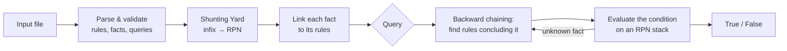

<div align="center">

# Expert System

**A propositional logic inference engine in Python: give it rules and known facts, it deduces the rest by backward chaining.**


</div>

---

## Overview

An expert system reasons the way you would on paper: from a set of **rules** (`A + B => C`) and **initial facts** (`A` and `B` are true), it answers **queries** (is `C` true?).

This one parses an input file, converts each rule to **Reverse Polish Notation** with the **Shunting Yard algorithm**, then resolves every query with a **backward chaining** engine: to prove a fact, it looks for the rules that conclude it and recursively proves their conditions.

| Feature | Details |
|---|---|
| **Parser** | Rules, facts and queries, with detailed error messages on invalid files |
| **Engine** | Backward chaining on rules converted to RPN, with cycle protection |
| **Contradictions** | Detects ambiguous rule sets where a fact would be both true and false |
| **Verbose mode** | `-v` explains every reasoning step in plain language |
| **Bonus** | Biconditional rules (`<=>`) and OR / XOR in conclusions |
| **Tests** | 69 automated test cases: 45 valid scenarios and 24 invalid files |

---

## Setup

```sh
source ./setup.sh               # create the virtualenv and install dependencies
source ./setup.sh --deactivate  # remove it
```

The only dependency is [`sty`](https://pypi.org/project/sty/), used for coloured terminal output.

---

## Usage

```sh
python3 -B main.py [-v] [-h] file
```

| Option | Description |
|---|---|
| `file` | Input file with rules, facts and queries |
| `-v`, `--verbose` | Explain every reasoning step |
| `-h`, `--help` | Show the help message |

### Example

`example.txt`:

```
A + B => C        # rule: if A and B, then C
C ^ D => E        # rule: if C xor D, then E
E | F => G
(G + H) ^ (I | J) => K

=ABH              # initial facts: A, B and H are true
?K                # query: is K true?
```

```sh
$ python3 -B main.py example.txt
[INFO] Parsing data from file 'example.txt'...
[SUCCESS] Data parsed successfully.
[INFO] Starting backward chaining...
[SUCCESS] Backward chaining completed.
[INFO] K: True
```

With `-v`, the engine explains its reasoning:

```
[VERBOSE] Resolving rule D + E => B for fact 'B' in association with query 'A'
  - We know that 'D' is True.
  - We know that 'E' is True.
  ...
```

---

## Input syntax

| Symbol | Meaning | Example |
|---|---|---|
| `A` to `Z` | A fact (false unless stated or deduced) | `A` |
| `!` | NOT | `!A` |
| `+` | AND | `A + B` |
| `\|` | OR | `A \| B` |
| `^` | XOR | `A ^ B` |
| `( )` | Grouping | `(A + B) \| C` |
| `=>` | Implies | `A + B => C` |
| `<=>` | If and only if (bonus) | `A <=> B` |
| `=` | Initial facts line | `=ABH` |
| `?` | Queries line | `?K` |
| `#` | Comment | `# a comment` |

---

## 🔬 How it works



1. **Parsing**: each line is checked (balanced parentheses, operator placement, valid facts and queries), then split into rules, initial facts and queries.
2. **Shunting Yard**: every rule condition and conclusion is converted from infix notation (`(A + B) | C`) to RPN (`A B + C |`), which can be evaluated with a simple stack.
3. **Backward chaining**: for each query, the engine finds the rules whose conclusion contains it, evaluates their conditions, and recursively resolves any fact it does not know yet. A set of facts being resolved prevents infinite loops on circular rules.
4. **Conclusions**: compound conclusions (`=> A + B`, and the OR / XOR bonus) assign values to every fact they involve, and a contradiction raises an ambiguity error.

---

## Unit tests

```sh
python3 -B test.py        # run all tests
python3 -B test.py -v     # valid cases only
python3 -B test.py -i     # error cases only
```

| Category | What is tested |
|---|---|
| **Valid** | AND, OR, NOT, XOR, parentheses, several rules with the same conclusion, combined rules, biconditionals, OR / XOR in conclusions |
| **Invalid** | Empty file, missing rules / facts / queries, unbalanced parentheses, consecutive or misplaced operators, invalid facts or queries, ambiguous rule sets |

Each valid test file contains its expected results (`# A = True`), compared automatically to the engine's output.

---

## Project structure

```
ExpertSystem_42/
├── main.py                  # entry point
├── test.py                  # test runner
├── Sources/
│   ├── expert_system.py     # backward chaining engine
│   └── Tools/
│       ├── parse.py         # parsing and Shunting Yard
│       ├── check.py         # input validation
│       ├── classes.py       # Operator, FactNode, RuleNode, Data
│       ├── logger.py        # coloured and verbose output
│       └── ...
├── Tests/
│   ├── Valid/               # 46 scenarios with expected results
│   └── Invalid/             # 24 malformed inputs
└── setup.sh
```

---

<div align="center">

Made by **Melody BOY** · 42 Nice · [GitHub](https://github.com/mboy29)

</div>
